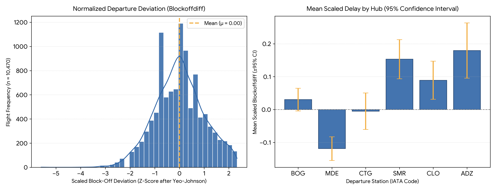

  

    9+ Years
    Operations & Analytics Leadership
  

  

    200+
    Daily Flights Managed in Real-Time Hub Control
  

  

    10+ Stations
    Digitalized with 85%+ On-Time Performance
  

  

    End-to-End
    Python, SQL, Power BI & Process Automation
  

## What I Deliver

  

    <h3>Data Analytics & Modeling</h3>
    
Exploratory data analysis, statistical inference, dimensionality reduction (PCA), and predictive modeling in Python and SQL to uncover root causes and forecast operational bottlenecks.

  

  

    <h3>BI & Executive KPIs</h3>
    
Design of automated Power BI dashboards and KPI architectures that translate complex, high-frequency operational logs into clear decision-support visuals for leadership teams.

  

  

    <h3>Process Automation & Lean</h3>
    
Custom workflow applications built with Microsoft Power Platform and Google AppSheet, backed by Lean Six Sigma methodologies to eliminate manual reporting and turnaround delays.

  

## Featured Projects & Case Studies

  <h3>1. Flight Delay Prediction & Operational Variance Analysis</h3>
  
End-to-end statistical and machine learning workflow analyzing historical airline departure records (<code>Blockoffdiff</code>) to isolate delay drivers, engineer operational features, and build predictive delay models.

  
  

    Python
    Pandas & NumPy
    Statistical Modeling
    Aviation Analytics
  

  <a href="python-projects.html" class="btn-portfolio">Explore Python Projects</a>
  <a href="https://github.com/diegojaimes0306-bit/diegojaimes0306-bit.github.io/blob/main/flight-delay-analysis.ipynb" class="btn-portfolio">View Jupyter Notebook</a>

  <h3>2. Enterprise KPI Dashboards & Multi-Station Digitalization</h3>
  
Architected executive Power BI reporting suites and mobile operational control apps (Power Apps & Google AppSheet) across 10+ airport stations and external consulting clients (including Copa Holdings, Dowrige, and MLBM Clinics), sustaining >85% network on-time performance.

  

    Power BI
    Power Apps & Automate
    Google AppSheet
    Lean Six Sigma
  

## Executive Profile & Credentials

Data & Operations Analyst combining an **M.Sc. in Operations Management** and an **Aeronautical Engineering** degree with hands-on leadership across airline hub control (Avianca), airport innovation (OPAIN), multi-station operations (Ultra Air, Wingo), and analytics consulting (BICTUS). I bridge high-pressure operational judgment with technical execution to build scalable, data-driven systems across any industry.

* **Education:** M.Sc. in Operations Management & Specialist in Production and Operations Management (Universidad de la Sabana) • B.Sc. in Aeronautical Engineering (Universidad de San Buenaventura)
* **Certifications:** Lean Six Sigma Yellow Belt • Foundations of Business Strategy (UVA Darden) • Airport Operations (CEA)
* **Core Stack:** Python • SQL • Power BI • Power Platform (Power Apps, Power Automate) • Google AppSheet • Operations Research & Simulation

## Let's Work Together

  <strong>Open to Global Opportunities & Consulting Engagements</strong> 
  Available for full-time roles in <strong>Data Analytics, Business Intelligence, or Operations Solution Consulting</strong> (open to immediate relocation to <strong>Dubai or Madrid</strong> and up to 50% travel), as well as freelance BI and process automation projects.  
  <strong>Connect:</strong> <a href="https://www.linkedin.com/in/diegoenriquejaimes/?locale=en-US">LinkedIn</a> • <a href="https://github.com/diegojaimes0306-bit">GitHub</a> • Based in Bogotá, Colombia

