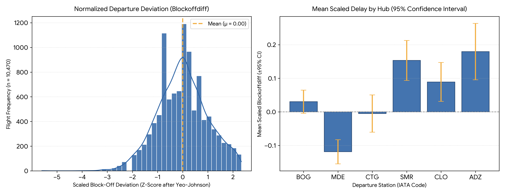

---
---

# Operational Delay & Turnaround Analysis (Python)

[← Back to Home](./index.md)

**Live Code Repository:** [View Full Jupyter Notebook (`flight-delay-analysis.ipynb`)](https://github.com/diegojaimes0306-bit/diegojaimes0306-bit.github.io/blob/main/flight-delay-analysis.ipynb)

---

## 1. Business Context & Operational Objective
In commercial airline Hub Control, minor departure deviations (`Blockoffdiff`) trigger cascading reaction delays across aircraft rotations, gate assignments, and crew schedules.

Using an operational dataset of **10,470 operated commercial flights**, this end-to-end statistical and feature-engineering pipeline evaluates how departure stations, passenger loads, aircraft tails, and schedule blocks impact departure punctuality—preparing a leak-free feature matrix for predictive modeling.

---

## 2. Statistical Methodology & Key Findings

### A. Data Hygiene & Leakage Prevention
* **Operational Filtering:** Excluded canceled legs (`Canceled == True`) to isolate continuous departure deviation behavior across **10,470 valid flights** with zero missing values.
* **Data Leakage Elimination:** Removed post-departure target-derived flags (`Delay`, `Canceled`) and principal components (`PC1`, `PC2`) from the predictor matrix (*X*) so predictive models rely strictly on pre-departure operational inputs.

### B. Distribution Normalization (Yeo-Johnson & Standard Scaling)
* Raw departure delays exhibit strong right-skewness driven by irregular operations (IROPS), weather, and ATC holds.
* Applied **Yeo-Johnson power transformations** followed by **Z-score standardization** (mean = 0.00, std = 1.00) to stabilize variance and mitigate extreme outlier distortion prior to parametric testing and regression modeling.

### C. Inferential Validation (ANOVA & 95% Confidence Intervals)
* **One-Way ANOVA across Departure Stations:** Tested whether departure station (`Depstring`) significantly drives departure deviation (*H0*: equal mean deviation across hubs). The test yielded **F = 16.75** with **p = 6.10e-25** (*p* < 0.001), confirming statistically significant station-level operational differences.
* **Hub Performance Benchmark (95% CI):** High-frequency hub **MDE** (*n* = 2,705) outperformed the network average with a mean scaled deviation of **-0.12**, whereas leisure/coastal stations such as **ADZ** (**+0.18**) and **SMR** (**+0.15**) showed higher positive delay pressure. **BOG** (*n* = 2,854) remained stable near the network baseline (**+0.03**) despite handling the highest flight volume.



---

## 3. Feature Engineering Architecture (`df_entregable_ml`)
Structured a **78-feature matrix (*X*)** paired with the normalized continuous target **`Blockoffdiff_escalado` (*y*)**:

* **Continuous Predictors (1):** Standardized passenger load (`Pax_escalado_final`).
* **One-Hot Encoded Operational Dimensions (77):**
  * **Aircraft Tail (`Vehicleregistration`):** 6 binary features capturing tail-specific turnaround profiles.
  * **Origin & Destination (`Depstring`, `Arrstring`):** 23 station indicators capturing airport congestion and ground-handling turnaround dynamics.
  * **City-Pair Routes (`Route`):** 48 route-level indicators capturing sector-specific airspace and turnaround buffers.

```python
import pandas as pd
import scipy.stats as st

# Load leak-free operational dataset (10,470 operated flights)
df = pd.read_csv("df_entregable_ml.csv")

# Separate Feature Matrix (X) and Normalized Target (y)
y = df["Blockoffdiff_escalado"]
X = df.drop(columns=["Blockoffdiff_escalado", "Legdate"])

# Inferential validation: One-Way ANOVA across departure stations (n >= 30)
dep_cols = [c for c in df.columns if c.startswith("Depstring_")]
df["Depstring"] = df[dep_cols].idxmax(axis=1).str.replace("Depstring_", "")

groups = [g["Blockoffdiff_escalado"].values for _, g in df.groupby("Depstring") if len(g) >= 30]
f_stat, p_val = st.f_oneway(*groups)

print(f"ANOVA F-statistic: {f_stat:.2f} | p-value: {p_val:.2e}")
